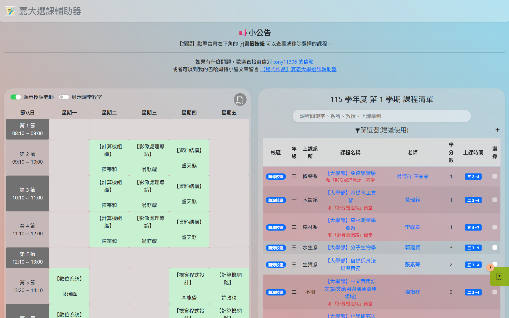
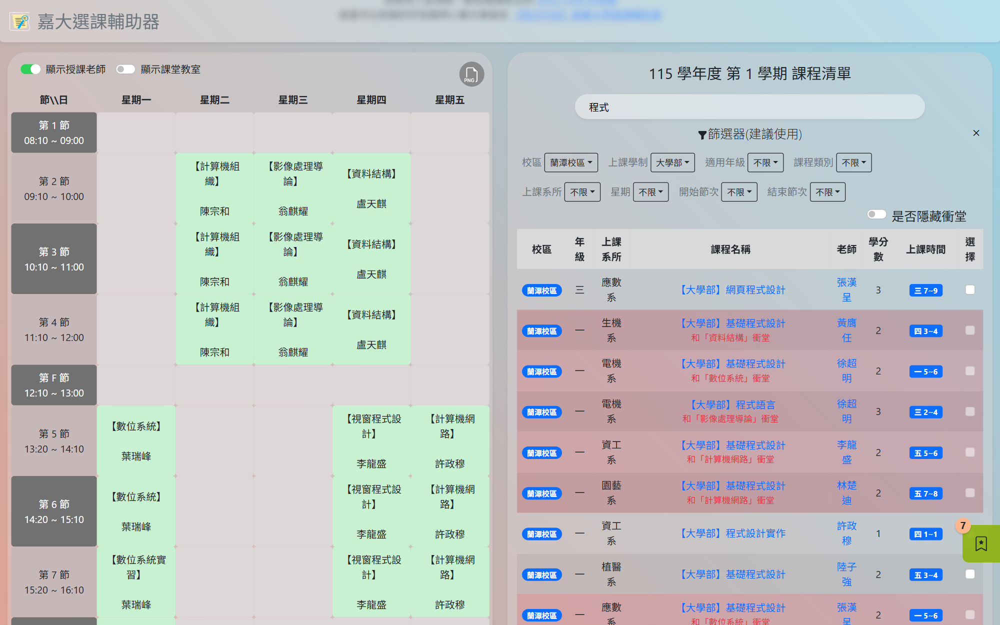
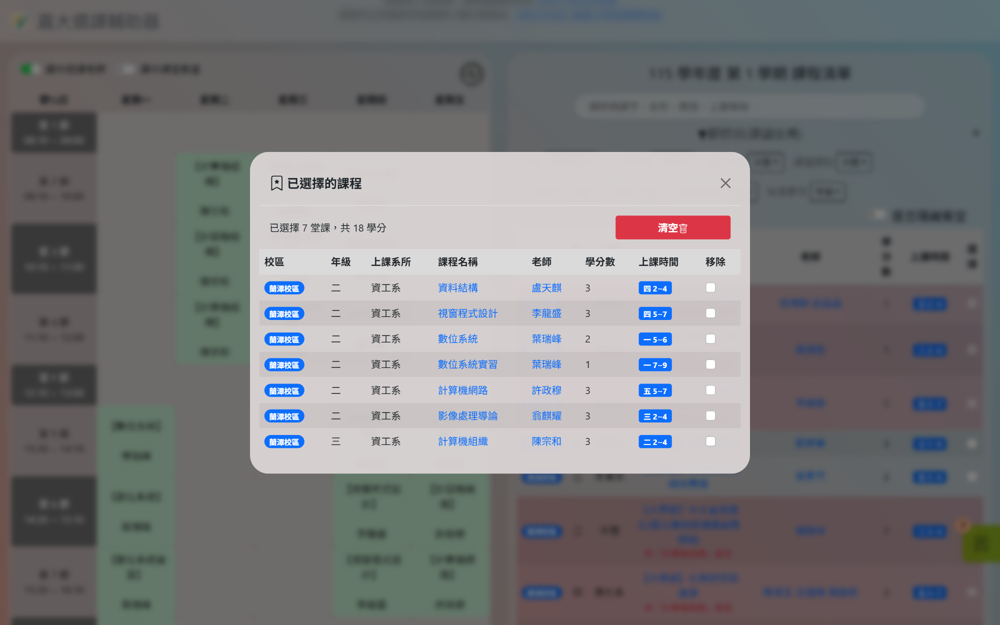
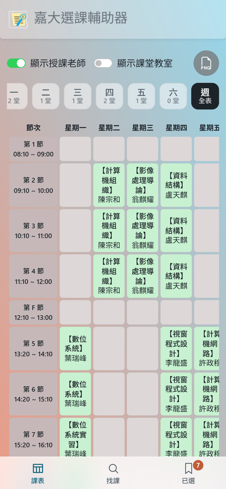
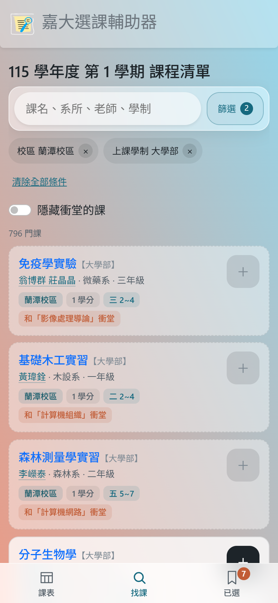
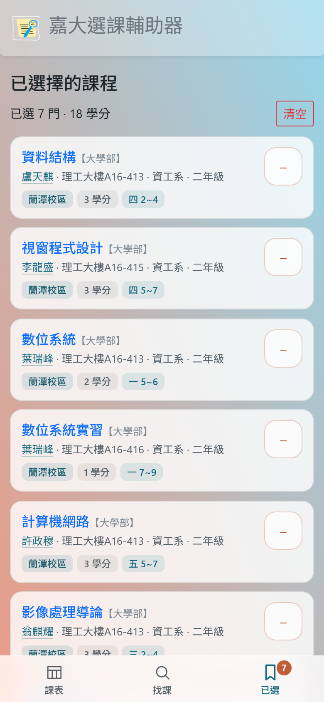
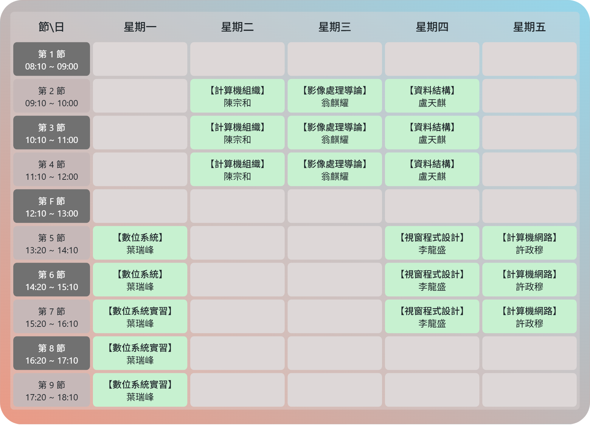

# [嘉大選課輔助器](https://tony11306.github.io/Chiayi-university-course-selection-support/)

嘉義大學的選課輔助網頁，用 React 寫的。相比原本的選課系統，多了這些功能：

- 選課時直接預覽課表
- 衝堂的課會鎖住，並顯示跟哪一堂衝
- 可以用校區、學制、年級、系所、星期、節次篩選
- 點課名看教學大綱，點老師名字可以搜尋評價
- 課表可以下載成圖片
- 選好的課會存在瀏覽器，下次打開還在
- 有手機版

## 畫面

### 搜尋、篩選、衝堂提示

### 已選課程

### 手機版

<table>
  <tr>
    <td align="center"></td>
    <td align="center"></td>
    <td align="center"></td>
    <td align="center"></td>
  </tr>
  <tr>
    <td align="center">單日課表</td>
    <td align="center">整週課表</td>
    <td align="center">找課</td>
    <td align="center">已選課程</td>
  </tr>
</table>

### 下載的課表圖片

